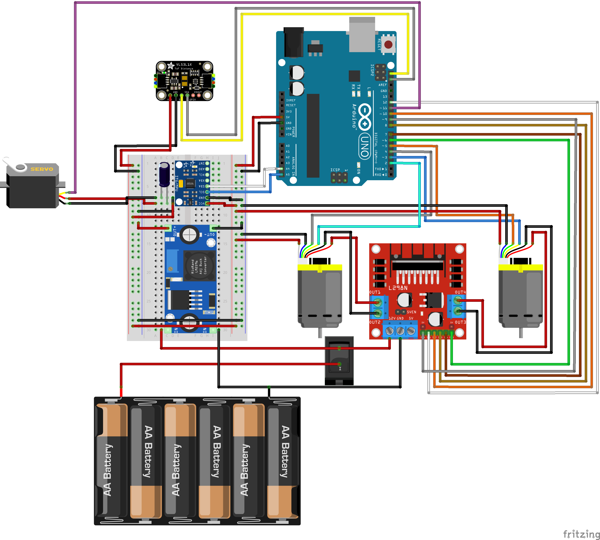

# RoomMapper

A small Arduino robot that maps the room around it. A VL53L1X distance sensor on a servo sweeps side to side to measure how far away things are while the robot drives around.

Still a work in progress.

## Hardware

- Arduino Uno WiFi
- Adafruit VL53L1X time-of-flight sensor
- Servo
- MPU-6050
- L298N motor driver + 2 DC motors with encoders
- LM2596 buck converter
- 6x AA battery pack



> **Note:** this diagram is outdated. Some pins have moved, including the servo and motor driver pins. The tables under [Wiring](#wiring) are the current wiring.

## Wiring

The breadboard has a 5V rail and a GND rail, both fed by the buck converter.

### Power

| From | To |
| --- | --- |
| Battery + | Switch, then L298N 12V and buck IN+ |
| Battery - | L298N GND and buck IN- |
| Buck OUT+ (set to 5V) | 5V rail |
| Buck OUT- | GND rail |
| 5V rail | Arduino 5V |
| GND rail | Arduino GND |

When the Arduino is plugged into USB with the battery in, disconnect the wire from the 5V rail to Arduino 5V so the buck and USB don't both power the board.

### L298N motor driver

The ENA and ENB jumper caps are removed so the Arduino controls motor speed.

| L298N | Arduino | Job |
| --- | --- | --- |
| ENA | D6 (PWM) | Right motor speed |
| IN1 | D7 | Right motor forward |
| IN2 | D8 | Right motor reverse |
| IN3 | D9 | Left motor reverse |
| IN4 | D10 | Left motor forward |
| ENB | D11 (PWM) | Left motor speed |

The right motor goes to OUT1/OUT2 and the left motor to OUT3/OUT4. The left motor's leads are reversed on purpose, which is why IN4 is its forward pin. The right motor is mounted flipped, so the code reverses its encoder count.

### Encoders

| Wire | Left motor | Right motor |
| --- | --- | --- |
| A | D2 | D3 |
| B | D4 | D5 |
| V+ | 5V rail | 5V rail |
| GND | GND rail | GND rail |

A has to be on D2 or D3, the Uno's two interrupt pins.

### Servo

| Wire | To |
| --- | --- |
| Signal | D12 |
| Power | 5V rail |
| Ground | GND rail |

The servo is on D12 because the Servo library stops PWM on D9 and D10. Those pins still work as plain digital pins, which is all IN3 and IN4 need.

### I2C sensors

The VL53L1X (address 0x29) and the MPU-6050 (address 0x68) share the I2C bus.

| Sensor pin | VL53L1X | MPU-6050 |
| --- | --- | --- |
| VIN / VCC | 5V rail | 5V rail |
| GND | GND rail | GND rail |
| SDA | SDA (A4) | SDA (A4) |
| SCL | SCL (A5) | SCL (A5) |

## Usage

Built with [PlatformIO](https://platformio.org/).

```sh
pio run -t upload       # build and upload
pio device monitor      # serial monitor (115200 baud)
```

`src/main.cpp` is still empty. Until it's written, each part gets tested with the [scratch sketches](#scratch-sketches).

## Tests

`test_vl53l1x` runs on the board, so the sensor needs to be connected and pointed at something within 4 m. It checks the sensor ID, starts ranging and makes sure the distance is in range.

```sh
pio test -f test_vl53l1x
```

## Scratch sketches

`src/scratch/` holds small standalone sketches for poking at one piece of hardware at a time. They're left out of the main build. To run one, point the `scratch` env in `platformio.ini` at it:

```ini
[env:scratch]
extends = env:uno
build_src_filter = +<scratch/mpu_raw.cpp>
```

Then build, upload and open the monitor with that env:

```sh
pio run -e scratch -t upload
pio device monitor -e scratch
```

| Sketch | What it does |
| --- | --- |
| `blink.cpp` | Blinks the onboard LED to check the board is alive |
| `i2c_scan.cpp` | Prints the address of every device on the I2C bus |
| `mpu_raw.cpp` | Reads raw accelerometer and gyro values from the MPU-6050 |
| `vl53_raw.cpp` | Prints distance readings from the VL53L1X. Expect them to be about 25–30 mm short of the real distance (tested at 300, 500 and 1000 mm) |
| `servo_sweep.cpp` | Sweeps the servo back and forth three times, then holds it at centre so you can mount things to it. Watch that it moves smoothly |
| `servo_goto.cpp` | Type an angle (0–180, decimals ok) + Enter and the servo sweeps there at a steady speed. Starts at 90 |
| `encoder_raw.cpp` | Prints both encoder counts while you spin the wheels by hand (USB only, no battery needed) |
| `motor_test.cpp` | Runs each motor forward then backward while printing encoder counts, to check direction and wiring. Type `g` + Enter in the monitor to start and `s` + Enter to stop; a watchdog resets the board if it hangs. Wheels off the ground, battery in, and the buck converter's wire to the Arduino 5V pin disconnected |
